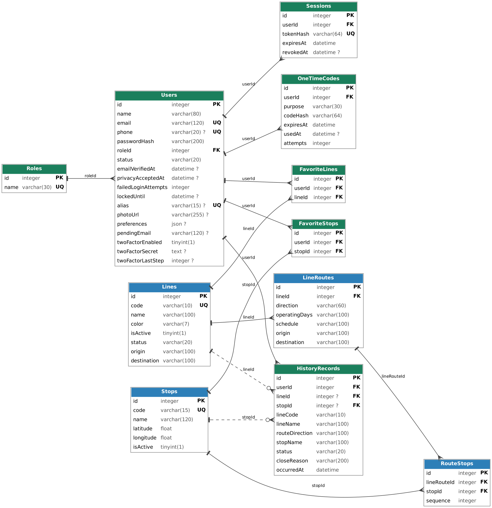

# Modelo relacional vigente (Entrega 2)

Este modelo se generó leyendo la base de datos real después de ejecutar las 12 migraciones (`backend/src/database/migrations`), así que coincide con el código. Muestra las **11 tablas implementadas**. Se omiten `createdAt` y `updatedAt`, que existen en todas.

Leyenda: `PK` llave primaria, `FK` llave foránea, `UQ` valor único, `?` admite nulo. Línea continua: relación obligatoria. Línea punteada: relación opcional (puede quedar vacía). Verde: módulo de cuentas. Azul: módulo de red de transporte.

## Entidades por módulo

**Cuentas (ACC)**

| Tabla | Qué guarda | Requerimientos |
|---|---|---|
| `Roles` | pasajero, conductor y administrador | ACC-01 (el registro público solo crea pasajeros) |
| `Users` | datos de la cuenta, estado, verificación, bloqueo temporal, preferencias (JSON), alias, foto, correo pendiente y datos del 2FA | ACC-01, 02, 04, 05, 06 |
| `Sessions` | sesiones abiertas: se guarda el hash del token, no el token | ACC-02, 03 |
| `OneTimeCodes` | códigos de un solo uso (verificación, recuperación, cambio de correo), con hash, vencimiento e intentos | ACC-01, 04, 05 |
| `FavoriteLines` / `FavoriteStops` | líneas y paraderos favoritos de cada pasajero | ACC-05, RED-01, RED-02 |
| `HistoryRecords` | solicitudes de parada del pasajero | ACC-07 |

**Red de transporte (RED)**

| Tabla | Qué guarda | Requerimientos |
|---|---|---|
| `Lines` | código, nombre, color, origen, destino y estado (activa o suspendida) | RED-01 |
| `LineRoutes` | cada sentido de una línea, con días y horario de funcionamiento | RED-01 |
| `Stops` | código, nombre y coordenadas del paradero | RED-02 |
| `RouteStops` | paraderos de un recorrido, con su orden (`sequence`) | RED-01, RED-02 |

## Relaciones

| Relación | Cardinalidad | Al borrar el padre |
|---|---|---|
| `Roles` → `Users` | 1 a N | no permite borrar |
| `Users` → `Sessions`, `OneTimeCodes`, `FavoriteLines`, `FavoriteStops`, `HistoryRecords` | 1 a N | se borran sus filas |
| `Lines` → `LineRoutes` | 1 a N | se borran sus recorridos |
| `LineRoutes` → `RouteStops` y `Stops` → `RouteStops` | N a N (tabla intermedia con orden) | se borra el vínculo |
| `Lines` → `FavoriteLines` y `Stops` → `FavoriteStops` | 1 a N | se borra el favorito |
| `Lines` → `HistoryRecords` y `Stops` → `HistoryRecords` | 1 a N, opcional | el vínculo pasa a vacío; el registro **se conserva** |

## Decisiones de diseño que conviene explicar

- **El historial guarda una copia de los nombres.** `HistoryRecords` repite el código y nombre de la línea, el sentido y el nombre del paradero. Así, si una línea o un paradero se desactiva o se elimina, el registro anterior sigue completo, como exige ACC-07.
- **Contraseñas y tokens nunca se guardan en claro.** La contraseña usa scrypt (`passwordHash`), el token de sesión y los códigos se guardan como hash, y el secreto del 2FA se guarda cifrado.
- **Los datos privados del usuario viven solo en `Users`.** Las preferencias son un campo JSON, porque cambian con frecuencia y no se consultan por separado.
- **El bloqueo por intentos fallidos** (`failedLoginAttempts`, `lockedUntil`) se comparte entre el inicio de sesión, la verificación en dos pasos y el cambio de contraseña.

## Ajustes respecto de la primera entrega

El diagrama de la primera entrega (`Diagrama de base de datos.jpeg`) describía el sistema completo. Al implementar se ajustó así:

| Primera entrega | Ahora | Motivo |
|---|---|---|
| `usuarios`, `pasajeros`, `conductores` separados | Una sola `Users` más `Roles` | El alias y el teléfono pertenecen a toda cuenta; el rol decide qué puede hacer. Los datos propios de conductor se agregarán con su módulo. |
| `contrasena` | `passwordHash` (scrypt) y campos de estado, verificación, bloqueo y 2FA | Seguridad y validaciones de ACC-01, 02 y 04 |
| `recorridos`: línea y sentido | `LineRoutes` con días, horario, origen y destino | RED-01 exige mostrar días y horarios |
| *(no existía)* | `RouteStops` | RED-01 exige paraderos ordenados según el sentido |
| `pasajero_paradero_favorito` | `FavoriteLines` y `FavoriteStops` | ACC-05 incluye líneas y paraderos favoritos |
| *(no existía)* | `Sessions` y `OneTimeCodes` | Sesiones seguras, verificación de correo y recuperación de contraseña |
| `solicitudes_parada` | `HistoryRecords` (por ahora) | Para ACC-07 se guarda lo que el pasajero necesita ver |

## Entidades planificadas para después

`conductores`, `vehiculos`, `turnos`, `viajes` y `solicitudes_parada` pertenecen a módulos que no forman parte de esta entrega. Cuando existan, `HistoryRecords` pasará a apuntar a `solicitudes_parada` (cada registro del historial será una solicitud real), y `Users` se relacionará con `conductores` mediante el rol.

## Datos de prueba

`npm run db:reset` (en `backend`) crea las tablas y carga el seed: 3 roles, 3 líneas, 6 recorridos, 10 paraderos, una cuenta de demostración con favoritos y 6 registros de historial. Los datos son ficticios.
